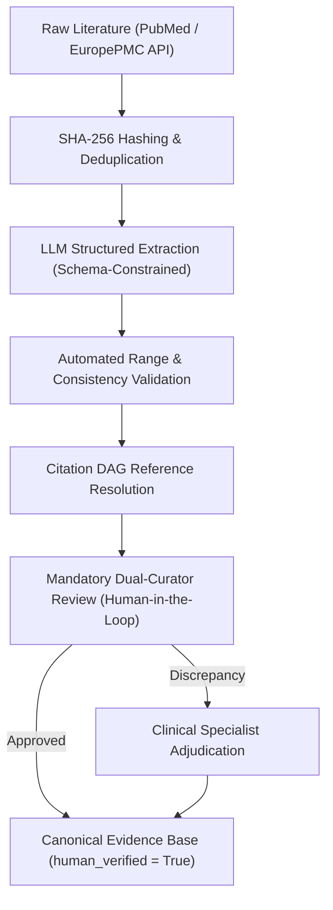

# Dataset Scaling and Multi-Task Data Collection Specification

This document provides the standard operating procedure (SOP) and data-collection specification for scaling the Herb–Drug Interaction (HDI) literature repository from the initial verified benchmark (141 records, 120 pairs) to a comprehensive biomedical atlas (>1,000 pairs) with zero synthetic records and auditable provenance.

---

## 1. Core Principles & Zero-Synthetic Data Policy

1. **Strict Provenance Integrity:** Every record must originate from authentic peer-reviewed literature, clinical trial registries (ClinicalTrials.gov), or regulatory monographs (FDA, EMA, WHO). No simulated, LLM-hallucinated, or synthetic records are permitted.
2. **Persistent Bibliographic Anchors:** Each study must carry a globally unique identifier:
   - Primary: PubMed ID (`PMID:XXXXXXXX`)
   - Secondary: Digital Object Identifier (`DOI:10.XXXX/...`)
   - Tertiary: Clinical trial registry identifier (`NCT:XXXXXXXX`)
3. **SHA-256 Text Fingerprinting:** The source excerpt, abstract, or full-text report must be hashed using SHA-256 (`source_text_sha256`) to ensure immutability and tamper-evident audit trails.

---

## 2. LLM-Assisted Curation Pipeline with Mandatory Human Verification

### Protocol Steps:
1. **Automated Fetching:** Query PubMed using validated search strings (`"<Botanical Name>"[Mesh] AND "<Drug Name>"[Mesh] AND ("pharmacokinetics"[Subheading] OR "herb-drug interaction")`).
2. **Ingestion & Cryptographic Hashing:** Raw abstract or full text is stored and hashed (`sha256 = hashlib.sha256(text.encode('utf-8')).hexdigest()`).
3. **Schema-Constrained LLM Extraction:** Prompting enforces strict JSON Schema matching `docs/evidence_schema.md`.
4. **Automated Sanity Validation:**
   - Herb entities validated against NCBI Taxonomy and Kew Plants of the World Online (POWO).
   - Drug entities validated against DrugBank / RxNorm.
   - Evidence types mapped to the 8 standard tiers (`rct`, `clinical`, `case_report`, `observational`, `animal`, `in_vitro`, `mechanistic`, `in_silico`).
5. **Mandatory Human Verification:**
   - Every candidate record is initialized with `human_verified: false`.
   - A biomedical curator or clinical pharmacist verifies extracted parameters against the original PDF/text.
   - Upon verification, `human_verified` is set to `true`, and `curator_id`, `verification_timestamp`, and `curator_notes` are appended. Unverified candidate records are never ingested into the benchmark test splits.

---

## 3. Auxiliary Target Annotations (Phase 8 Task Extensions)

To transition HDI prediction from binary presence/absence to actionable clinical pharmacology, the architecture supports three auxiliary multi-task targets:

### 3.1 Interaction Direction (Binary Classification)
Indicates the pharmacokinetic impact on victim drug systemic exposure:
- **`0: decreased_exposure`**: Significant reduction in drug bioavailability or circulating concentration (e.g. CYP3A4 induction by St. John's Wort decreasing Cyclosporine exposure).
- **`1: increased_exposure`**: Significant elevation in victim drug concentration or reduced clearance (e.g. CYP3A4 inhibition increasing Alprazolam exposure).
- **`-1: unannotated / missing`**: Unlabeled studies; loss is masked during multi-task training.

### 3.2 Clinical Severity Grade (3-Class Ordinal Classification)
Standardized according to FDA / Lexicomp clinical interaction risk classifications:
- **`0: mild (minor)`**: Minimal clinical consequence; no dosage adjustment or monitoring typically required.
- **`1: moderate`**: Clinically relevant interaction; may require therapeutic drug monitoring (TDM), dose titration, or clinical vigilance.
- **`2: severe (major / contraindication)`**: Potentially life-threatening toxicity, organ rejection, or therapeutic failure; combination should be avoided or routed to high-priority pharmacist review routing.
- **`-1: unannotated / missing`**: Loss is masked.

### 3.3 Quantitative Pharmacokinetic Log Fold-Change (Continuous Regression)
For clinical pharmacology studies reporting area under the concentration-time curve (AUC) or peak concentration ($C_{\max}$):
$$\Delta \ln(\text{AUC}) = \ln\left(\frac{\text{AUC}_{\text{herb+drug}}}{\text{AUC}_{\text{drug alone}}}\right)$$
$$\Delta \ln(C_{\max}) = \ln\left(\frac{C_{\max,\text{herb+drug}}}{C_{\max,\text{drug alone}}}\right)$$
- If the victim drug exposure drops to $50\%$ ($\text{AUC ratio} = 0.50$), $\Delta \ln(\text{AUC}) = \ln(0.50) \approx -0.693$.
- If exposure doubles ($\text{AUC ratio} = 2.0$), $\Delta \ln(\text{AUC}) = \ln(2.0) \approx +0.693$.
- Unmeasured studies carry `NaN`; masked by `~torch.isnan(target_pk_fold_change)`.

---

## 4. Multi-Task Loss Masking Formulation

The total multi-task loss is parameterized as:
$$\mathcal{L}_{\text{total}} = w_{\text{int}} \mathcal{L}_{\text{interaction}} + w_{\text{dir}} \mathcal{L}_{\text{direction}} + w_{\text{sev}} \mathcal{L}_{\text{severity}} + w_{\text{pk}} \mathcal{L}_{\text{pk\_regression}}$$

Where:
$$\mathcal{L}_{\text{direction}} = \frac{1}{\sum_{i} m_i^{\text{dir}}} \sum_{i} m_i^{\text{dir}} \cdot \text{BCEWithLogits}\left(\hat{y}_i^{\text{dir}}, y_i^{\text{dir}}\right), \quad m_i^{\text{dir}} = \mathbb{I}(y_i^{\text{dir}} \in \{0, 1\})$$

$$\mathcal{L}_{\text{severity}} = \frac{1}{\sum_{i} m_i^{\text{sev}}} \sum_{i} m_i^{\text{sev}} \cdot \text{CrossEntropy}\left(\hat{\mathbf{z}}_i^{\text{sev}}, y_i^{\text{sev}}\right), \quad m_i^{\text{sev}} = \mathbb{I}(y_i^{\text{sev}} \in \{0, 1, 2\})$$

$$\mathcal{L}_{\text{pk\_regression}} = \frac{1}{\sum_{i} m_i^{\text{pk}}} \sum_{i} m_i^{\text{pk}} \cdot \text{SmoothL1}\left(\hat{y}_i^{\text{pk}}, y_i^{\text{pk}}\right), \quad m_i^{\text{pk}} = \mathbb{I}(y_i^{\text{pk}} \text{ is not NaN})$$

Default weights: $w_{\text{int}} = 1.0, w_{\text{dir}} = 0.5, w_{\text{sev}} = 0.5, w_{\text{pk}} = 0.25$.
When auxiliary targets are unannotated for a batch, masks gracefully collapse their loss contributions to 0.0 with full backward compatibility.
